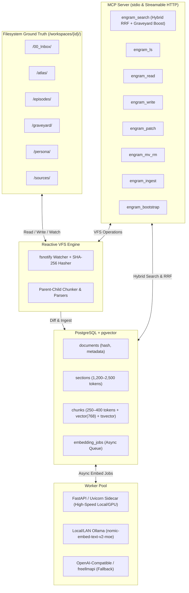

# Engram-MCP 🧠

[](https://golang.org)
[](LICENSE)
[](https://modelcontextprotocol.io)

**Engram-MCP** is a production-grade, self-hosted Knowledge & Agent Memory Engine written in idiomatic Go. It couples a human-accessible filesystem ground truth (compatible with Obsidian, Copyparty, and WebDAV) with a high-performance PostgreSQL + `pgvector` index and a Model Context Protocol (MCP) server.

Designed for AI coding agents (Google Antigravity, Claude Code) and human researchers, Engram-MCP provides durable, long-term memory across years of work without trapping user notes inside proprietary or opaque vector silos.

---

## 🌟 Core Architectural Highlights



### 1. Filesystem-First Ground Truth
- All human notes, logs, and raw files live in standard directory trees on disk.
- You can browse and edit your notes directly in **Obsidian**, manage uploads via **Copyparty** or WebDAV, or edit via standard command-line tools.
- Removing, editing, or creating a file updates PostgreSQL automatically via a reactive file watcher and SHA-256 content-hash reconciliation loop.

### 2. "Mechanism Over Policy"
- The Go engine provides clean, orthogonal primitives: Virtual Filesystem (VFS) operations, parent-child chunk indexing, hybrid search, and instruction bootstrapping.
- Folder conventions and workflow rules are governed by instructions seeded dynamically into `AGENTS.md` / `GEMINI.md` via `engram_bootstrap`.

### 3. Parent-Child Chunking for `nomic-embed-text-v2-moe`
- **The 512-Token Ceiling:** `nomic-embed-text-v2-moe` has a hard 512-token context limit.
- **Parent Sections:** 1,200–2,500 tokens of full Markdown context (preserving headings, tables, and code blocks) are stored in the `sections` table.
- **Child Chunks:** Strictly 250–400 tokens (50-token sliding overlap) are embedded with the mandatory `search_document: ` task prefix.
- At retrieval time, high-similarity child chunks resolve to their full parent sections.

### 4. Hybrid Search with Reciprocal Rank Fusion (RRF) & Safety Boosting
- **Semantic Leg:** HNSW cosine similarity (`<=>`) on child chunk vectors.
- **Lexical Leg:** Full-Text Search (`ts_rank_cd` over `tsvector`) supporting language dictionaries (`english`, `german`) and code identifiers (`simple`).
- **Metadata & Temporal Leg:** Strict SQL filtering by path prefix, YAML frontmatter tags, and ISO date ranges.
- **The Graveyard Guardrail:** Searches automatically check `/graveyard/` records to surface relevant past failures and post-mortems alongside primary hits.

---

## 🛠️ The 8 MCP Tools

| Tool | Purpose | Key Inputs |
| :--- | :--- | :--- |
| `engram_search` | Hybrid RRF vector + keyword search with graveyard boost | `query`, `paths`, `tags`, `date_from`, `date_to`, `top_k` |
| `engram_ls` | Inspect files and directories with indexing status | `path`, `recursive`, `pattern` |
| `engram_read` | Read raw Markdown content or extract section/line range | `path`, `section_or_line_range` |
| `engram_write` | Atomically write/overwrite document and queue indexing | `path`, `content`, `overwrite` |
| `engram_patch` | Modifies existing documents or appends episodic logs | `path`, `operation`, `target`, `content` |
| `engram_mv_rm` | Move/rename files without re-indexing, or safely delete to `.trash/` | `action`, `source_path`, `dest_path` |
| `engram_ingest` | Parse and index binary files (PDF, DOCX, CSV, XLSX) into vectors | `path`, `generate_summary_md` |
| `engram_bootstrap`| Emit or seed workspace workflow rules into `AGENTS.md` / `GEMINI.md` | `target_type`, `custom_rules` |

---

## 📂 Default Workspace Taxonomy

```
/workspaces/{workspace_id}/
├── /00_Inbox/       # Staging area for unverified ideas requiring human review
├── /atlas/          # Validated domain knowledge, code patterns, paper syntheses
├── /episodes/       # Chronological logs (YYYY-MM-DD_topic.md) recording session history
├── /graveyard/      # Post-mortems of failed approaches and dead ends (auto-boosted)
├── /persona/        # User preferences, coding guidelines, agent_rules.md template
└── /sources/        # Ingested PDF/DOCX publications and research datasets
```

---

## 🚀 Getting Started

### Prerequisites
- Go 1.24+
- PostgreSQL 16+ with `pgvector` extension enabled
- (Optional) [Ollama](https://ollama.ai) running `nomic-ai/nomic-embed-text-v2-moe`

### Installation
```bash
git clone https://github.com/windowsfreak/engram-mcp.git
cd engram-mcp
go build -o engram ./cmd/engram
```

### Running with Claude Desktop or Google Antigravity
Add to your MCP client configuration (e.g., `claude_desktop_config.json` or Antigravity MCP settings):

```json
{
  "mcpServers": {
    "engram": {
      "command": "/path/to/engram",
      "args": ["serve-stdio", "--config", "/path/to/config.yaml"]
    }
  }
}
```

---

## 📖 Documentation
- [Architecture & Design Details](ARCHITECTURE_STATE.md)
- [Deployment Topologies](docs/TOPOLOGIES.md) (Local All-in-One, Split Home/Lab, Server Cloud with Copyparty)
- [Task Tracker & Roadmap](TASK_TRACKER.md)
