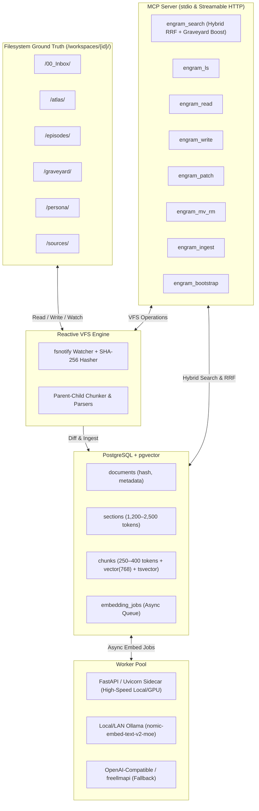

# Engram-MCP 🧠

[](https://golang.org)
[](LICENSE)
[](https://modelcontextprotocol.io)

**Engram-MCP** is a production-grade, self-hosted Knowledge & Agent Memory Engine written in idiomatic Go. It couples a human-accessible filesystem ground truth (compatible with Obsidian, Copyparty, and WebDAV) with a high-performance PostgreSQL + `pgvector` index and a Model Context Protocol (MCP) server.

Designed for AI coding agents (Google Antigravity, Claude Code) and human researchers, Engram-MCP provides durable, long-term memory across years of work without trapping user notes inside proprietary or opaque vector silos.

---

## 🌟 Core Architectural Highlights



### 1. Filesystem-First Ground Truth
- All human notes, logs, and raw files live in standard directory trees on disk.
- You can browse and edit your notes directly in **Obsidian**, manage uploads via **Copyparty** or WebDAV, or edit via standard command-line tools.
- Removing, editing, or creating a file updates PostgreSQL automatically via a reactive file watcher and SHA-256 content-hash reconciliation loop.

### 2. "Mechanism Over Policy"
- The Go engine provides clean, orthogonal primitives: Virtual Filesystem (VFS) operations, parent-child chunk indexing, hybrid search, and instruction bootstrapping.
- Folder conventions and workflow rules are governed by instructions seeded dynamically into `AGENTS.md` / `GEMINI.md` via `engram_bootstrap`.

### 3. Parent-Child Chunking for `nomic-embed-text-v2-moe`
- **The 512-Token Ceiling:** `nomic-embed-text-v2-moe` has a hard 512-token context limit.
- **Parent Sections:** 1,200–2,500 tokens of full Markdown context (preserving headings, tables, and code blocks) are stored in the `sections` table.
- **Child Chunks:** Strictly 250–400 tokens (50-token sliding overlap) are embedded with the mandatory `search_document: ` task prefix.
- At retrieval time, high-similarity child chunks resolve to their full parent sections.

### 4. Hybrid Search with Reciprocal Rank Fusion (RRF) & Safety Boosting
- **Semantic Leg:** HNSW cosine similarity (`<=>`) on child chunk vectors.
- **Lexical Leg:** Full-Text Search (`ts_rank_cd` over `tsvector`) supporting language dictionaries (`english`, `german`) and code identifiers (`simple`).
- **Metadata & Temporal Leg:** Strict SQL filtering by path prefix, YAML frontmatter tags, and ISO date ranges.
- **The Graveyard Guardrail:** Searches automatically check `/graveyard/` records to surface relevant past failures and post-mortems alongside primary hits.

---

## 🛠️ The 8 MCP Tools

| Tool | Purpose | Key Inputs |
| :--- | :--- | :--- |
| `engram_search` | Hybrid RRF vector + keyword search with graveyard boost | `query`, `paths`, `tags`, `date_from`, `date_to`, `top_k` |
| `engram_ls` | Inspect files and directories with indexing status | `path`, `recursive`, `pattern` |
| `engram_read` | Read raw Markdown content or extract section/line range | `path`, `section_or_line_range` |
| `engram_write` | Atomically write/overwrite document and queue indexing | `path`, `content`, `overwrite` |
| `engram_patch` | Modifies existing documents or appends episodic logs | `path`, `operation`, `target`, `content` |
| `engram_mv_rm` | Move/rename files without re-indexing, or safely delete to `.trash/` | `action`, `source_path`, `dest_path` |
| `engram_ingest` | Parse and index binary files (PDF, DOCX, CSV, XLSX) into vectors | `path`, `generate_summary_md` |
| `engram_bootstrap`| Emit or seed workspace workflow rules into `AGENTS.md` / `GEMINI.md` | `target_type`, `custom_rules` |

---

## 📂 Default Workspace Taxonomy

```
/workspaces/{workspace_id}/
├── /00_Inbox/       # Staging area for unverified ideas requiring human review
├── /atlas/          # Validated domain knowledge, code patterns, paper syntheses
├── /episodes/       # Chronological logs (YYYY-MM-DD_topic.md) recording session history
├── /graveyard/      # Post-mortems of failed approaches and dead ends (auto-boosted)
├── /persona/        # User preferences, coding guidelines, agent_rules.md template
└── /sources/        # Ingested PDF/DOCX publications and research datasets
```

---

## 🚀 Getting Started

### Prerequisites & Infrastructure

You need a PostgreSQL database with `pgvector` enabled and an embedding provider. **You do NOT need Python or a local interpreter installed**—all dependencies can be started with a single Docker command, or you can use native services:

#### 1. Instant PostgreSQL + pgvector (Recommended)
If you do not have PostgreSQL with `pgvector` installed on your machine, simply launch it via Docker:
```bash
# Starts PostgreSQL 16 + pgvector and the embedding sidecar in the background
docker compose up -d pgvector embed-sidecar
```
*(Your database will be available at `localhost:5432` with user/password `postgres/postgres`, matching `config.yaml` out of the box).*

#### 2. Choosing the Best Embedding Method for Your Hardware

Engram-MCP supports three embedder backends (configured via `provider` in `config.yaml`). Because vector embedding is compute-intensive, your optimal setup depends on your operating system and hardware:

| Platform | Recommended Method | Why | Setup |
| :--- | :--- | :--- | :--- |
| **macOS (M1/M2/M3/M4)** | **Native Ollama** *(or Native Sidecar via `uv`)* | Docker on macOS **cannot** access Apple Silicon Metal GPU (`mps`) and falls back to slow CPU emulation. Native Ollama uses Metal out of the box. | `ollama pull nomic-embed-text-v2-moe`<br>Set `provider: ollama` |
| **Linux (NVIDIA GPU)** | **Docker Sidecar** | Docker on Linux has native CUDA passthrough with 0% container performance penalty. | `docker compose up -d embed-sidecar`<br>Set `provider: sidecar` |
| **Windows (NVIDIA GPU)** | **Docker Sidecar** or **Native Ollama** | WSL2 provides near-native CUDA GPU passthrough to Docker; Native Ollama runs directly on Windows CUDA. | `docker compose up -d embed-sidecar` or native Ollama |
| **No Local GPU / Cloud** | **OpenAI-Compatible** | Zero local compute or memory overhead. Offloads embeddings to any remote endpoint (e.g. freellmapi). | Set `provider: openai` + API key |

##### How to start each embedding option:

- **Method A: Native Ollama (Recommended for Apple Silicon Mac)**
  ```bash
  ollama pull nomic-embed-text-v2-moe
  ```
  In `config.yaml`:
  ```yaml
  embedder:
    provider: "ollama"
    ollama:
      base_url: "http://localhost:11434"
      model: "nomic-embed-text-v2-moe"
  ```

- **Method B: Docker Sidecar (Recommended for Linux / WSL2 with NVIDIA GPU)**
  ```bash
  docker compose up -d embed-sidecar
  ```
  In `config.yaml`:
  ```yaml
  embedder:
    provider: "sidecar"
    sidecar:
      base_url: "http://localhost:8001"
  ```

- **Method C: Native Python Sidecar via `uv` (For Apple Silicon or bare-metal setups)**
  ```bash
  uv run --python 3.12 --with fastapi --with "uvicorn[standard]" --with sentence-transformers --with "transformers<5.0.0" --with torch --with einops python sidecar/main.py
  ```

- **Method D: OpenAI / Compatible API (Zero local GPU required)**
  In `config.yaml`:
  ```yaml
  embedder:
    provider: "openai"
    openai:
      base_url: "https://api.openai.com/v1"
      api_key: "your-api-key"
      model: "text-embedding-3-small"
  ```

---

### Installation

**Option A: Pre-compiled binaries (Recommended)**
Download the latest executable for your platform from [GitHub Releases](https://github.com/windowsfreak/engram-mcp/releases):
- **Windows (x64):** `engram_windows_amd64.zip` (extract `engram.exe`)
- **Linux (x64):** `engram_linux_amd64.tar.gz`
- **macOS (Apple Silicon / Intel):** `engram_mac_arm64.tar.gz` / `engram_mac_amd64.tar.gz`

**Option B: Build from source**
```bash
git clone https://github.com/windowsfreak/engram-mcp.git
cd engram-mcp
go build -o engram ./cmd/engram      # On Windows: go build -o engram.exe ./cmd/engram
```

### Running with Claude Desktop or Google Antigravity

**macOS / Linux:**
```json
{
  "mcpServers": {
    "engram": {
      "command": "/path/to/engram",
      "args": ["serve-stdio", "--config", "/path/to/config.yaml"]
    }
  }
}
```

**Windows (`%APPDATA%\Claude\claude_desktop_config.json`):**
```json
{
  "mcpServers": {
    "engram": {
      "command": "C:\\path\\to\\engram.exe",
      "args": ["serve-stdio", "--config", "C:\\path\\to\\config.yaml"]
    }
  }
}
```
*(Tip: Forward slashes `C:/path/to/engram.exe` are also valid in JSON configurations on Windows)*

---

## 📖 Documentation
- [Architecture & Design Details](ARCHITECTURE_STATE.md)
- [Deployment Topologies](docs/TOPOLOGIES.md) (Local All-in-One, Split Home/Lab, Server Cloud with Copyparty)
- [Task Tracker & Roadmap](TASK_TRACKER.md)
