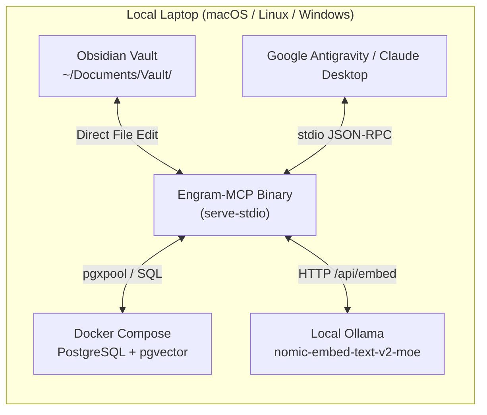

# Deployment Topologies & Architecture Recipes

Engram-MCP is architected for maximum deployment flexibility. Because the filesystem is ground truth and PostgreSQL + `pgvector` acts as a reactive index, you can deploy Engram-MCP across a variety of hardware configurations.

---

## Topology 1: Local All-in-One (Single Workstation)

Ideal for individual researchers, developers, or offline-capable setups.



### Setup Steps:
1. **Start `pgvector` container:**
   ```bash
   docker run -d --name engram-pgvector -p 5432:5432 \
     -e POSTGRES_PASSWORD=postgres -e POSTGRES_DB=engram \
     pgvector/pgvector:pg16
   ```
2. **Run Ollama with `nomic-embed-text-v2-moe`:**
   ```bash
   ollama pull nomic-ai/nomic-embed-text-v2-moe
   ```
3. **Configure MCP client (Antigravity or Claude Desktop):**
   Add to your MCP configuration:
   ```json
   {
     "mcpServers": {
       "engram": {
         "command": "/usr/local/bin/engram",
         "args": ["serve-stdio", "--config", "/path/to/config.yaml"]
       }
     }
   }
   ```
4. **Point Obsidian to your workspace directory** (e.g. `./data/workspaces/default`). Any file created or updated in Obsidian is automatically chunked and vector indexed within milliseconds.

---

## Topology 2: Split Home/Lab Setup (vServer + NAS Worker)

Designed for distributed hardware setups: a low-cost cloud vServer paired with a high-performance local server or NAS running local LLM embeddings.

```mermaid
graph TD
    subgraph Cloud ["Frankfurt Cloud vServer (4 vCPU, 16 GB RAM)"]
        CADDY["Caddy Reverse Proxy<br/>(HTTPS + SSE)"]
        PG["PostgreSQL + pgvector"]
        ENGRAM_SRV["Engram-MCP<br/>(serve-http)"]
    end

    subgraph HomeLab ["Home/Lab NAS (20-Core, 96 GB RAM)"]
        OLLAMA_NAS["Ollama Cluster<br/>(nomic-embed-text-v2-moe)"]
    end

    subgraph Clients ["Client Workstations"]
        OBS_CLIENT["Obsidian (Local Sync)"]
        AGENT["Google Antigravity / Claude Code"]
    end

    CADDY -->|Reverse Proxy| ENGRAM_SRV
    ENGRAM_SRV <-->|SQL| PG
    ENGRAM_SRV <-->|Tailscale / WireGuard (HTTP)| OLLAMA_NAS
    AGENT <-->|Remote HTTP /sse| CADDY
    OBS_CLIENT <-->|Sync| CADDY
```

### Highlights:
* **WireGuard / Tailscale Tunnel:** Connects Frankfurt cloud vServer to the 20-core NAS, keeping embedding calls fast and private over the LAN tunnel.
* **Persistent PostgreSQL Queue:** If the home NAS goes offline or reboots, jobs remain safely buffered in the `embedding_jobs` table and resume automatically when connectivity is restored.
* **Fallback Provider (`freellmapi`):** If Ollama is unavailable, the queue can automatically route high-priority jobs through OpenAI-compatible fallback endpoints.

---

## Topology 3: Zero-UI Server Cloud with Copyparty

Mount and manage your remote knowledge base without any custom web UI, pairing Engram-MCP with **Copyparty** (high-performance file server with Web UI, WebDAV, deduplication, and media streaming).

```mermaid
graph TD
    subgraph CloudNode ["Central Server / VPS"]
        CAD["Caddy Reverse Proxy"]
        ENGRAM["Engram-MCP HTTP Server (:8080)"]
        COPYPARTY["Copyparty (:3923)"]
        DB["PostgreSQL + pgvector"]
        VOL["/data/workspaces/{workspace_id}/"]
    end

    subgraph EndUsers ["Users & Agents"]
        BROWSER["Web Browser (Drag-and-Drop PDFs / Search)"]
        OBS_WEBDAV["Obsidian via WebDAV"]
        AI_AGENT["Google Antigravity (Remote MCP)"]
    end

    CAD -->|/mcp, /sse| ENGRAM
    CAD -->|/files (Web & WebDAV)| COPYPARTY
    COPYPARTY <-->|Direct Disk Access| VOL
    ENGRAM <-->|VFS Watcher & Ground Truth| VOL
    ENGRAM <-->|Index & Search| DB

    BROWSER <-->|Upload & Browse| CAD
    OBS_WEBDAV <-->|Sync via WebDAV| CAD
    AI_AGENT <-->|MCP Protocol| CAD
```

### Why Copyparty + Engram-MCP is the Ultimate Combination:
1. **Zero UI Maintenance:** Copyparty provides a blazing-fast, mobile-friendly Web UI for uploading 500-page PDFs, organizing folders, and streaming audio.
2. **Native WebDAV:** Mount the remote workspace as a local drive on Windows, macOS, or Linux, allowing Obsidian to open the vault directly over WebDAV.
3. **Reactive Re-indexing:** When a user uploads a new PDF or edits a note in Copyparty, Engram's `fsnotify` watcher instantly detects the disk change, extracts parent sections, generates 350-token child chunks, and embeds them into `pgvector`.
